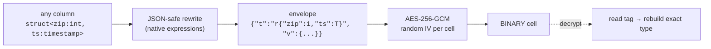

<div align="center">

# 🔐 CryPySpark

**Encrypt any PySpark column. Decrypt it back to the exact same value *and* type.**

Structs, arrays, maps, decimals, timestamps, binary, nested as deep as you like.<br>
No UDFs, one line of code, and it works with Databricks.

[](https://github.com/seanpavlak/CryPySpark/blob/main/LICENSE)


</div>

```python
import crypyspark

enc = df.encrypt("ssn", "address", "orders", key="correct horse battery staple")
dec = enc.decrypt(key="correct horse battery staple")

assert dec.collect() == df.collect()   # same values, same types, nested and all
```

---

## Contents

- [Why CryPySpark](#-why-crypyspark)
- [Install](#-install)
- [Quickstart](#-quickstart)
- [Databricks](#-databricks)
- [Supported types](#-supported-types)
- [How it works](#-how-it-works)
- [Performance](#-performance)
- [API reference](#-api-reference)
- [Security notes](#-security-notes)
- [FAQ](#-faq)
- [Development](#-development)
- [License](#-license)

---

## ✨ Why CryPySpark

Spark has `aes_encrypt`, but it only takes `STRING`/`BINARY` and gives back bytes. Encrypting a `struct<street:string, zip:int, geo:array<double>>` or a `map<date, array<binary>>` means writing your own serialization. Then you have to remember every column's original type to decrypt it. CryPySpark does that part for you.

| | |
|---|---|
| 🧬 **Any type, any depth** | Primitives, decimals, dates, timestamps (incl. NTZ), binary, ANSI intervals, and arbitrarily nested `struct` / `array` / `map`, including maps with non-string keys. |
| 🎯 **Exact round trip** | NaN, ±Infinity, `-0.0`, 38-digit decimals, microsecond timestamps, raw bytes and unicode all come back unchanged. |
| 🏷️ **Self-describing ciphertext** | Every encrypted cell carries a compact type tag, so a column decrypts correctly even after a trip through CSV or a `select` that dropped its metadata. |
| ⚡ **Fast** | Native Spark SQL expressions only, so everything runs in the JVM and Photon with no Python workers. See [Performance](#-performance). |
| 🧱 **Databricks-native** | Classic, shared and serverless compute (Spark Connect), keys from Databricks secrets, and Unity Catalog governance tags. |
| 🪶 **Tiny** | Pure Python with zero dependencies beyond the PySpark you already have. |

---

## 📦 Install

```bash
pip install crypyspark
```

On Databricks:

```python
%pip install crypyspark
```

You can also attach the wheel as a cluster, job or serverless environment library. PySpark isn't a hard dependency, so the runtime's own PySpark is used. To install it locally, use `pip install "crypyspark[spark]"`.

---

## 🚀 Quickstart

```python
import crypyspark                       # importing adds df.encrypt / df.decrypt
from pyspark.sql import functions as F

KEY = "correct horse battery staple"    # any passphrase, bytes, or Column

people = spark.createDataFrame(
    [(1, "123-45-6789", ("1 Main St", 12345), {"2024-01-01": 9.99})],
    "id int, ssn string, address struct<street:string,zip:int>, spend map<string,double>",
)

# 🔒 Encrypt: columns become BINARY ciphertext, in place, order preserved
enc = people.encrypt("ssn", "address", "spend", key=KEY)
enc.printSchema()
# root
#  |-- id: integer
#  |-- ssn: binary
#  |-- address: binary
#  |-- spend: binary

# 🔓 Decrypt: original types come back automatically
dec = enc.decrypt(key=KEY)              # no names = every column encrypt() touched
dec.printSchema()
# root
#  |-- id: integer
#  |-- ssn: string
#  |-- address: struct<street:string,zip:int>
#  |-- spend: map<string,double>
```

### Common recipes

```python
# Set the key once, then forget about it
crypyspark.set_key(KEY)
enc = people.encrypt("ssn", "address")
dec = enc.decrypt()

# Encrypt one field inside a struct and leave the rest readable
enc = people.encrypt("address.zip")

# Text output for CSV / JSON sinks (base64)
people.encrypt("ssn", as_string=True).write.csv("/tmp/out")

# Don't fail the job on a wrong key or tampered cell: get NULL instead
enc.decrypt("ssn", key="wrong", on_error="null")

# Column-level API for select() / withColumn() when you know the type
enc = people.select("id", crypyspark.encrypt_column("ssn", "string").alias("ssn"))
dec = enc.select("id", crypyspark.decrypt_column("ssn", "string").alias("ssn"))
```

---

## 🧱 Databricks

### 1. Keep the key in a secret

```python
import crypyspark

crypyspark.set_key(crypyspark.secret_key("pii-scope", "customer-key"))
```

`secret_key` uses Databricks' SQL `secret()` function, so the key is resolved **inside the engine**. It never passes through Python and never shows up in `EXPLAIN` or the Spark UI.

> A key from `dbutils.secrets.get(...)` passed as a plain string also works. It gets derived into a constant in the query plan, though, so prefer `secret_key`.

### 2. Write encrypted tables with Unity Catalog governance tags

```python
from crypyspark import databricks as cdb

cdb.save_encrypted_table(
    customers,
    "main.crm.customers",
    ["ssn", "email", "address"],
    extra_tags={"pii": "true", "owner": "data-platform"},
)
```

Each encrypted column gets [governance tags](https://docs.databricks.com/en/database-objects/tags.html):

| Tag | Value | Purpose |
|---|---|---|
| `crypyspark_encrypted` | `aes-256-gcm` | Find every encrypted column in your lakehouse, and drive tag-based (ABAC) policies |
| `crypyspark_type` | compact type tag, e.g. `r{"street":s,"zip":i}` | Lets readers decrypt without sampling any data |
| *your `extra_tags`* | anything | Classification, ownership, etc. |

They show up in Catalog Explorer and in `information_schema.column_tags`:

```sql
SELECT table_name, column_name, tag_value AS original_type
FROM main.information_schema.column_tags
WHERE tag_name = 'crypyspark_type';
```

### 3. Read it back decrypted

```python
customers = cdb.read_decrypted_table("main.crm.customers")
```

This finds the encrypted columns from the UC tags and takes their types from `crypyspark_type`, so nothing extra runs. Off Unity Catalog, it falls back to schema metadata and then to the type tag stored in the data.

### Other helpers

```python
cdb.tag_encrypted_columns("main.crm.customers")   # tag an already-written table
cdb.encrypted_columns("main.crm.customers")       # {"ssn": "s", "address": 'r{"street":s,"zip":i}', ...}
```

> Setting tags needs the `APPLY TAG` privilege on the table. Tags go on top-level columns. An encrypted nested field (`"address.zip"`) stays self-describing through its data.

### Compatibility

| Compute | Supported |
|---|---|
| Classic (single user / no isolation) | ✅ |
| Shared access mode (Unity Catalog) | ✅ |
| Serverless notebooks & jobs (Spark Connect) | ✅ |
| Databricks SQL warehouses | Data written by CryPySpark can be read; encrypt/decrypt are a Python API |
| Runtime | DBR 14.0+ (Spark 3.5+) |

---

## 🧬 Supported types

| Spark type | | Notes |
|---|:-:|---|
| `boolean`, `tinyint`, `smallint`, `int`, `bigint` | ✅ | |
| `float`, `double` | ✅ | NaN, ±Infinity and `-0.0` preserved |
| `decimal(p, s)` | ✅ | Full 38-digit precision, scale kept |
| `string`, `char`, `varchar` | ✅ | Any unicode, including control characters |
| `binary` | ✅ | Every byte value |
| `date` | ✅ | `0001-01-01` … `9999-12-31` |
| `timestamp` | ✅ | Microsecond-exact, independent of session time zone |
| `timestamp_ntz` | ✅ | Microsecond-exact |
| `interval day to second`, `interval year to month` | ✅ | ANSI intervals, all field ranges |
| `array<T>` | ✅ | Null elements preserved |
| `map<K, V>` | ✅ | **Any** key type (int, date, struct, ...), not just strings |
| `struct<...>` | ✅ | Any field names, including dots, quotes and commas |
| Nested combinations | ✅ | `array<map<string, struct<ts:timestamp, tags:array<map<bigint,date>>>>>` is in the test suite |
| `NULL` (at any level) | ✅ | Top-level NULLs are encrypted too, so whether a value is null isn't leaked |
| `variant`, `calendar interval` | ❌ | Raises a clear `TypeError` |

---

## 🔬 How it works



1. **JSON-safe rewrite.** Types JSON would mangle are rewritten losslessly with native Spark functions:

   | Type | Rewritten as |
   |---|---|
   | timestamps | epoch microseconds |
   | dates | epoch days |
   | binary | base64 |
   | maps | arrays of `{k, v}` entries |
   | `timestamp_ntz`, intervals | their exact string form |

   Types JSON already handles losslessly are left alone.
2. **Typed envelope.** The value is wrapped with a compact type tag. Atomic types are one character (`i`, `s`, `T`…), and complex types are spelled out (`a<m<i,t>>`, `r{"zip":i}`).
3. **Encryption.** `aes_encrypt(..., 'GCM')` with a 32-byte key derived via SHA-256 and a fresh random IV for every cell. GCM authenticates the ciphertext, so any tampering is detected.
4. **Decryption.** The type is resolved in this order:
   1. explicit `dtypes=`
   2. schema metadata
   3. Unity Catalog tags
   4. the tag inside the data, read with a single `LIMIT 1` job
   
   The value is then decrypted, parsed, and rebuilt into the original type.

---

## ⚡ Performance

Speed comes from these design choices:

- **No Python UDFs, ever.** Every step is a built-in Catalyst expression, fully code-generated and Photon-eligible. Rows never leave the JVM.
- **A single projection.** Encrypting or decrypting 50 columns adds **one** `select` to the plan, not 50 chained `withColumn`s.
- **Decrypt once per row.** The decrypted payload is bound to a lambda variable, so AES and JSON parsing run exactly once per cell no matter how many nested fields get rebuilt. This made struct decryption **~4× faster** in our benchmark.
- **Binary by default.** No base64 overhead unless you ask for `as_string=True`.
- **Compact tags.** An `int` column pays one byte of type metadata per cell.
- **No sampling when types are known.** With metadata or UC tags, decrypt plans without running any job.

Benchmark: 2,000,000 rows on a laptop (`local[*]`, cached input, `noop` sink):

| Operation | Time |
|---|---|
| Encrypt `string` column | ~2.0 s |
| Encrypt `struct<int, array<double>, timestamp>` | ~2.0 s |
| Decrypt `string` column | ~1.5 s |
| Decrypt `struct<int, array<double>, timestamp>` | ~1.7 s |

---

## 📚 API reference

### DataFrame methods (added on `import crypyspark`)

```python
df.encrypt(*columns, key=None, as_string=False) -> DataFrame
```
Encrypts each column in place: the column becomes `BINARY`, or `STRING` (base64) with `as_string=True`. Columns can be given as varargs or lists, and `"parent.child"` targets a struct field.

```python
df.decrypt(*columns, key=None, dtypes=None, on_error="raise") -> DataFrame
```
Restores original values and types. With no columns, it decrypts every column `encrypt` tagged. Use `dtypes={"col": DataType | "ddl" | "tag"}` to override type detection, and `on_error="null"` to get `NULL` for cells that fail to decrypt. Base64 string columns are handled automatically.

### Column functions

```python
crypyspark.encrypt_column(col, dtype, key=None, as_string=False) -> Column
crypyspark.decrypt_column(col, dtype, key=None, on_error="raise", as_string=False) -> Column
crypyspark.type_tag_column(col, key=None, as_string=False) -> Column   # the tag inside each cell
```

### Keys & types

```python
crypyspark.set_key(key)                  # default for every call; None clears it
crypyspark.secret_key(scope, name)       # Databricks secret, resolved in-engine
crypyspark.parse_type("array<int>")      # DataType from DDL, type tag, or DataType
```

### `crypyspark.databricks`

```python
save_encrypted_table(df, table, columns, key=None, mode="overwrite", extra_tags=None) -> DataFrame
read_decrypted_table(table, key=None, columns=None, on_error="raise") -> DataFrame
tag_encrypted_columns(table, columns=None, extra_tags=None) -> list[str]
encrypted_columns(table) -> dict[str, str | None]
```

---

## 🛡️ Security notes

- **Cipher:** AES-256-GCM (authenticated encryption) via Spark's built-in `aes_encrypt`. A wrong key or modified ciphertext fails loudly, or gives `NULL` with `on_error="null"`.
- **Randomised:** every cell gets a fresh IV, so equal plaintexts produce different ciphertexts. You can't join or group on encrypted columns. Decrypt first.
- **Key derivation:** any key is passed through SHA-256 to get a 32-byte AES key. That's ideal for random secrets. If you use a human passphrase, make it long, because SHA-256 isn't a slow password hash.
- **Keys in plans:** keys passed as strings or bytes become literals in the Spark plan. Use `secret_key()` on Databricks to keep them out.
- **What's not hidden:** the approximate size of each value and whether a column is encrypted. Per-row type tags are inside the ciphertext. The `crypyspark_type` UC tag, if used, makes column types visible to anyone who can read table metadata.

---

## ❓ FAQ

<details>
<summary><b>Do I have to remember the column types to decrypt?</b></summary>

No. Every cell carries its own type tag. Delta preserves schema metadata, so `df.decrypt(key=...)` usually doesn't even need to touch the data to know the types.
</details>

<details>
<summary><b>Can I decrypt data that went through CSV, JSON, or another system?</b></summary>

Yes. Encrypt with `as_string=True` for text formats. On read, `decrypt` sees a string column, base64-decodes it, and recovers the type from the tag inside the data.
</details>

<details>
<summary><b>Does decrypting restore nullability flags too?</b></summary>

Values and data types are exact. Spark always marks decrypted fields as nullable, so a `NOT NULL` field comes back as nullable with the same values.
</details>

<details>
<summary><b>Can I rotate keys?</b></summary>

Yes: `df.decrypt(key=old).encrypt(cols, key=new)`. It's a single pass, and nothing touches Python.
</details>

<details>
<summary><b>Will it work in Databricks SQL?</b></summary>

The encrypt/decrypt API is Python. Tables written by CryPySpark are ordinary Delta tables, and their UC tags can be queried from SQL.
</details>

---

## 🛠️ Development

```bash
git clone https://github.com/seanpavlak/CryPySpark.git
cd CryPySpark
pip install -e ".[test]"
pytest                    # needs Java 17+ for local Spark
```

The test suite round-trips a schema containing every supported type, including edge values and deep nesting. It also covers metadata loss through CSV, nested-field encryption, wrong keys, Column keys, and type-tag parsing.

---

## 📄 License

[MIT](https://github.com/seanpavlak/CryPySpark/blob/main/LICENSE) © 2025 Sean Pavlak
